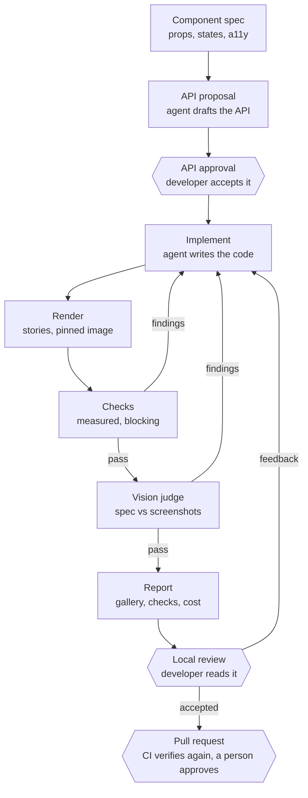

# Fazon: project brief

## Summary

Fazon is a framework that lets a coding agent build UI components from written specs, then proves each one by rendering it, checking it and judging it against its spec. Its first proof is an example Vue 3 component library of 15 components.

It has two parts:

- **Framework:** a CLI harness, agent skills, a verifier container image and a reusable CI workflow, in the `fazon` repository.
- **Example library:** tokens, specs, components and baselines, in the `fazon-vue-example` repository. It is the first consumer of the framework and the template for others.

Three rules shape every decision below:

- Deterministic tools check everything that can be measured.
- A vision model judges only what cannot be measured.
- A person decides at three points: the component's API before code is written, the local review of the result, and the pull request.

It starts as a portfolio project and is built so that others could use it. It shows agent-driven frontend development with published numbers for reliability and cost.

Version 1 is complete when milestones M0 to M5 are done. Publishing means releasing the packages to the npm registry and promoting the project. Whether to publish is decided once version 1 is complete, based on the results and on early interest. The repositories, the container image and GitHub releases are public during development, and that does not count as publishing.

Fazon is not meant to become an enterprise-ready product.

## Goals and non-goals

### Goals

- **Spec to component:** each component is generated from a spec through a capped loop. Any hand edit during a measured run is recorded.
- **Same verdict everywhere:** the checks run in one pinned container, so a laptop and CI agree on every screenshot.
- **A measured judge:** the vision judge is itself tested with seeded defects before its verdicts are trusted.
- **Adoptable:** another repo references the framework by version, then adds a config file, tokens and specs.
- **Published numbers:** first-pass rate, iterations and cost per component, plus the judge's catch rate and false-positive rate.
- **Framework-neutral core:** everything framework-specific sits behind an adapter. Version 1 ships the Vue adapter only.
- **Ready for others:** documentation and a license are in place from the start, and releases are versioned from M5, so a later decision to publish needs no rework.

### Non-goals for version 1

- No design tool integration. Specs and tokens are files in the repo.
- No hosted service and no cloud infrastructure.
- CI never generates code. Issue-to-PR automation is a later project.
- No second framework adapter and no Tailwind support until version 1 is finished.
- No application-level demo. A demo app can follow later.
- Not a replacement for a hosted visual-review product.
- Not an enterprise-ready product: no support commitment and no compatibility guarantee before 1.0.

## Users and journey

Three roles appear in this brief. One person can hold more than one.

- **Developer:** uses Fazon in a consumer repo. Writes the spec, approves the API, reviews the report and opens the pull request.
- **Reviewer:** reviews and merges that pull request.
- **Maintainer:** owns the Fazon repositories.

The developer is on a team that owns a component library and wants a new component that matches the system without writing it by hand.

1. **Adopt:** install the CLI and the skills plugin, then run `fazon init`. It writes the config file, a starter tokens file, a conventions doc and the CI workflow stub.
2. **Specify:** `fazon spec new button` scaffolds `specs/button.md` from the template. The spec skill then drafts it with the developer: purpose, props, variants, states and accessibility requirements. `fazon spec check` validates the file. A reference image is optional.
3. **Approve the API:** `fazon propose button` has the agent propose props, events and slots. The developer accepts or corrects them. No component code exists yet.
4. **Generate:** `fazon generate button` runs the loop until every check passes or a cap is reached.
5. **Review locally:** `fazon report` opens an HTML report with the screenshot gallery, check results, judge verdict and cost. Feedback in plain words re-enters the loop.
6. **Open a pull request:** CI renders and checks everything again from scratch and posts a summary. A reviewer approves and merges.
7. **Evolve:** after a token change, `fazon verify` re-renders every story and the visual diff shows which components moved.

## Repositories and deliverables

Two repositories: the framework (fazon), and an example component library (fazon-vue-example) that consumes it. Each framework added later gets its own example repo. A consumer references the framework by version and never copies it, because copies drift. The five deliverables share one version number and are released together.

### Framework repository

| Deliverable | Shipped as | A consumer uses it through |
| --- | --- | --- |
| CLI harness | npm package | a dev dependency and `npx` |
| Vue adapter | npm package | the `adapter` key in the config file |
| Agent skills | Claude Code plugin | a plugin install |
| Verifier image | container image, pinned by digest | the `image` key in the config file |
| CI workflow | reusable GitHub Actions workflow, versioned | a `uses:` line in a short workflow |

### Example library repository

It holds only what is specific to one design system:

- the tokens file and the conventions doc
- one spec per component
- components, stories and tests (generated, then reviewed)
- screenshot baselines
- the config file and a short workflow that calls the reusable one

The library is also the template: `fazon init` produces the same layout in a fresh repo.

### Component package

A consumer's library is always a valid package, whether or not it is ever published.

- **Scaffold:** the adapter sets up the library build, the type declarations and the package's exports map.
- **Entry file:** the harness keeps the package's entry file current as components are added. The agent does not edit it.
- **Check:** a package check builds and packs the library, then confirms that every export resolves and its types exist.
- **CI:** the packed tarball is attached as a workflow artifact, next to the Storybook build.
- **Publishing:** pushing the package to a registry is the adopter's job, with their credentials and their versioning. Fazon documents a recipe and never handles the credentials.

### Before packaging

The packaged deliverables arrive in M5, but the example repo consumes the framework from M1. Until M5 it pins one framework commit: the CLI and adapter as a git dependency, the reusable workflow by commit SHA, and the verifier image built in CI from that commit. This mechanism is a proposal and is confirmed in M0.

### Licensing

The framework is licensed GPL-3.0-or-later, and Gergő Drazsdik holds the copyright. Outside contributors sign a contributor license agreement, so the project can be relicensed later.

What Fazon writes into an adopter's repo must not pull that repo under the GPL. The proposal is that all of it carries a permissive license: the files from `fazon init`, the scaffolds from `fazon spec new`, and the generated stories, tests and components. The license of the example repo is open as well. Both are settled in M0.

## Inputs

The agent works from three files that people own. Everything else is generated.

### Tokens

The tokens file is the single source of truth for colors, spacing, type scale, radii, shadows and motion, in the [DTCG format](https://www.w3.org/community/reports/design-tokens/CG-FINAL-format-20251028/). It does three jobs:

- **Vocabulary:** the agent may only use values that exist as tokens.
- **Build source:** Style Dictionary turns it into CSS custom properties, with light and dark themes.
- **Check oracle:** a raw value in source fails lint, and a computed style that matches no token fails verification.

For the example library's tokens, the agent proposes a small neutral set during M0 and the maintainer approves it once. The draft lives in the framework repo's docs and moves to the example repo at M1. After that the values change only through a reviewed pull request. M0 also confirms which parts of the token format the build tool supports and pins that subset.

#### Themes

A theme is a switch over the same token names, not a second set of tokens.

- **Two layers:** raw tokens hold the values, such as the palette and the spacing steps. Role tokens name a purpose, such as `color.surface` or `color.text.primary`, and point at raw tokens. A theme only changes where the role tokens point.
- **Format:** in the token format a theme is a modifier with one context per option, layered over a shared foundation. Brand or density would each be a further modifier, and the combinations multiply.
- **Build:** the build emits one block of CSS custom properties per context, for example `:root` and `[data-theme="dark"]`. Components do not change between themes.
- **Rule for components:** a component references role tokens only. A reference to a raw token fails lint.
- **Verification:** token conformance and contrast run once per theme. The story matrix rules decide how much of the matrix runs outside the default theme.

Version 1 ships light and dark. The themes are declared with the token set, so a spec does not list them.

### Component spec

One Markdown file per component. The front matter is machine-readable and validated against a JSON Schema. The body is prose for the agent and the judge.

```markdown
---
name: Button
tier: primitive
props:
  variant: [primary, secondary, ghost]
  size: [sm, md, lg]
  disabled: boolean
  loading: boolean
slots: [default, icon]
events: [click]
states: [default, hover, focus-visible, active, disabled, loading]
a11y:
  role: button
  keyboard: [Enter, Space]
---
## Purpose
Triggers an action on the current page.

## Behaviour
- Loading shows a spinner in place of the icon and blocks clicks.

## Never
- Never used for navigation. Use Link.
```

The example shows the idea, not the final format. The format and its JSON Schema are an M0 document. It still has to settle how a story gets its content and fixtures, how multi-part components such as Tabs, Select and Dialog are described, how a check is exempted, and whether the API in a spec is framework-neutral.

The `props` block starts as the developer's intent. After the API approval step it holds the approved API, and the spec is the contract from then on.

A spec is added with a command and a skill that share one template and one schema:

- **`fazon spec new <name>`** scaffolds the file with every required field.
- **`fazon spec check`** validates one spec or all of them against the schema and the token names. CI runs it too.
- **The spec skill** drafts the content with the developer. It asks about purpose, variants and states, reads the existing specs so naming stays consistent, fills the scaffold and runs the check.

The command works without an agent. The skill never writes a spec the check would reject.

### Conventions doc

One file with the rules that span components: prop and event naming, slot patterns, file layout, how variants map to tokens, and which headless primitives to build on. The agent reads it on every run. M0 decides which of these rules become machine-checkable. Only those are enforced by a check.

## The loop

A deterministic harness owns the loop. The agent only edits files. The harness decides what runs next, enforces the caps and records every step.



Failed checks, judge findings and review feedback all return to the implement step. A run ends when everything passes or a cap is hit. Hexagons mark the three points where a person decides.

### Caps and stop rules

- **Iterations:** 5 per component by default. M0 defines what counts as one, including whether a review feedback round does.
- **Budget:** a cost cap per component, set in the config file. Judge calls count toward it.
- **Time:** a wall-clock limit per run.
- **Escalation:** after 2 failed iterations the harness switches to the stronger model.
- **Stop:** when a cap is hit, the run ends as "needs a person" with its findings attached. The harness never relaxes a check to get a run through. A check is waived only by an explicit exemption in the spec, which the reviewer sees in the pull request.

M0 sets the default budget and time limit and says where each cap is enforced.

### What the agent sees and may touch

- It receives the spec, the approved API, the tokens, the conventions doc and the latest findings.
- It may change only that component's files. It never edits baselines, tokens, checks or config.
- The harness enforces this itself. The Claude Code sandbox limits shell commands, not file edits, so the harness sets permission rules for the headless call and fails any run whose working tree shows changes outside the allowed paths.
- It runs as one headless `claude -p` call per iteration.

The agent permission model is an M0 document. It lists the allowed paths, the commands the agent may run itself (type-check, lint, tests), how the harness updates shared files such as the package's entry file, and the sandbox settings a run requires.

### Run record

Every run writes a JSON record: iterations, check results, judge findings, models, tokens, cost and duration. The report and every metric are built from these records. The records stay out of git. A small provenance file per component is committed: spec hash, iterations, models and cost.

### Report

`fazon report` builds a static HTML page from one run record. It is separate from Storybook. It holds the screenshots as PNG files next to the check results, judge findings and cost, so it opens without a server and works as a CI artifact. Each screenshot links to its live story in the local Storybook.

## Verification

Checks come in two kinds. Source checks (build, types, lint, unit tests) run on the code through commands the adapter supplies. Rendered checks run against a static Storybook build: the verifier reads Storybook's story index and visits each story's URL, so these checks never touch framework code. Both kinds run inside the verifier image, with dependencies installed in the image and never taken from the host.

M0 settles how the image's browser version stays matched to the consumer's lockfile, which CPU architecture screenshots are taken on, and the pixel tolerance.

### Story matrix

The harness generates the stories from the spec, so the agent does not choose what gets verified. The rules are an M0 document. They must settle which props span the matrix, how invalid combinations are pruned, how each state is produced (a prop, a CSS pseudo-state or an interaction script), what content a story renders, and how much of the matrix runs in each theme. Story names follow a fixed rule, so baseline file names stay stable.

### Deterministic checks (blocking)

| Check | Kind | Catches | Tooling |
| --- | --- | --- | --- |
| Build and types | source | code that does not compile | Vite, vue-tsc |
| Lint | source | style violations, raw colors or sizes in place of tokens, raw tokens in place of role tokens | ESLint, Stylelint with a token rule |
| Unit and interaction tests | source | wrong behaviour, events and keyboard handling | Vitest in browser mode |
| Package | source | a missing export, styles left out of the build, broken type declarations | library build and pack, then export and type resolution |
| Accessibility | rendered | missing roles and names, low contrast | axe through Playwright |
| Token conformance | rendered | computed styles that match no token | Playwright, computed styles |
| Layout | rendered | clipped or overflowing content, targets under 24 px | Playwright, bounding boxes |
| Visual diff | rendered | unintended change against a baseline | Playwright screenshots |

Each check gets a rule sheet in M0: its scope, the legitimate values it allows (such as `0`, `auto` or `currentColor` for token conformance), the exemption syntax, and one passing and one failing fixture. The framework's own tests run those fixtures.

### Vision judge

The judge covers what the checks cannot measure, mainly whether a new component looks like its spec says.

- **Input:** the spec, one labelled 2x crop per story, the pixel-diff image when a baseline exists, and the reference image if the spec has one. It never sees the code.
- **Rubric:** fixed questions built from the spec about what cannot be measured, such as "is disabled visibly different from default" or "does primary read as more prominent than secondary".
- **Output:** structured. A verdict per story (pass, fail or unsure) and findings with a severity.
- **Isolation:** a fresh context on every call, separate from the generator.
- **Authority:** advisory until the calibration in M3 meets the thresholds set in M0. After that, a fail in a local run goes back into the loop. An unsure verdict never blocks and is shown in the report. In CI the judge stays advisory by default.
- **Limits:** the [vision docs](https://platform.claude.com/docs/en/build-with-claude/vision) describe localization and counting as approximate, so nothing measurable is left to the judge.

### Baselines

- Baselines are PNG files committed in the consumer repo. They are created and updated only inside the verifier image, by a baseline command that the CLI reference names.
- With no baseline, the visual diff reports the story as new and does not fail.
- A baseline change is part of the pull request, so the reviewer sees the image diff. CI confirms that a fresh render matches the committed baselines, and treats a baseline as changed when it differs from the base branch.
- The reviewer accepts a new component's first baseline after the judge and a person have looked at it.

The full baseline lifecycle, including an intended change to an existing component, is an M0 document.

## CI

The reusable workflow verifies. It never generates or repairs code.

1. Build the static Storybook.
2. Run the source and rendered checks in the verifier image. These are the required checks.
3. Run the judge on stories whose screenshots are new or changed against the base branch.
4. Upload the HTML report, the Storybook build and the packed library as workflow artifacts, and write the job summary.

Rules:

- **Triggers:** verification runs on `pull_request` and never on `pull_request_target`. A separate job on pushes to `main` deploys the Storybook site to GitHub Pages.
- **Judge policy:** `advisory`, `blocking` or `off`, set per repo in the config file. The default is `advisory`, because a nondeterministic required check makes merges flaky. The judge has its own cost cap in CI and sends images in batches. Both are defined in the judge document in M0 and tuned in M3.
- **Forks:** the judge needs an API key secret, so it is skipped on pull requests from forks.
- **Permissions:** workflows are read-only and use no secrets until a milestone needs more: the judge's API key in M3, Pages in M4, image and release publishing in M5. The reusable workflow's inputs, secrets and permissions are an M0 document.
- **Supply chain:** actions are pinned by commit SHA. The image is signed and carries provenance. The npm packages are built in CI and attached to a GitHub release.

## Framework adapters

The core never imports framework code. An adapter supplies everything that differs between frameworks.

- **Core:** the tokens pipeline, the spec format and schema, the loop, run records, the verifier, every rendered check, the judge, the CI workflow and the report.
- **Adapter:** the project scaffold and Storybook framework config, the generation skill with the framework's idioms, story and test templates, the commands for the source checks (build, type-check, lint, test), guidance for the headless primitives library, and the conventions doc template.

All skills ship in one Claude Code plugin. An adapter contributes its generation skill to that plugin.

Adapters are built in this order:

1. Vue 3 (version 1)
2. Angular
3. React
4. Svelte
5. Web Components

All five are on Storybook's list of [supported frameworks](https://storybook.js.org/docs/get-started/frameworks).

The adapter interface stays internal and may change until the second adapter exists. The project calls itself framework-neutral in public only after that.

The Vue adapter targets single-file components with `<script setup lang="ts">`. Components with complex behaviour (Dialog, Select, Tabs, Tooltip) are built on Reka UI, so the agent writes styling and composition and does not reimplement focus management. How such multi-part components are specified, and how content rendered outside the story root is captured, is settled in M0.

Styling is a separate option inside an adapter. Version 1 writes plain CSS with custom properties. Tailwind support follows after version 1: the same tokens build the Tailwind theme, the lint rule bans arbitrary values the way it bans raw literals, and every check on rendered output stays the same.

## Measurement

The project's claim is its numbers, so measurement is part of the design and not a later add-on.

### Protocol

The measurement protocol is an M0 document. It defines a measured run (a fixed framework version on a clean checkout), what counts as an iteration, how many times each component is repeated, and what cost includes (proposal, generation, judge calls and failed runs). Every published number carries its repeat count.

### Loop metrics

Collected per component from the run records:

- first-pass rate: the share of components that pass on iteration 1
- iterations until everything passes
- cost and tokens
- wall-clock time
- human interventions: API corrections, feedback rounds and hand edits

### Judge calibration

- **Seeded defects:** take passing components and inject one known defect into each. Some are measurable, to compare the judge with the checks: wrong padding, a missing focus ring, clipped text, low-contrast text. Others only a viewer can see: a secondary button that looks more prominent than the primary, a state that is barely distinguishable, a component that looks out of family.
- **Measures:** catch rate per defect type, and false-positive rate on unmodified components.
- **Comparison:** the deterministic checks run on the same set, which shows the defects only the judge catches.
- **Stability:** each judge call is repeated to measure how often it agrees with itself.
- **Timing:** calibration runs in M3 on the first components and again after M4 on all 15.

Units, sample sizes and the thresholds for trusting the judge are in the measurement protocol.

### Experiments after version 1

- The loop with and without the judge: does the judge change the result, or only the cost?
- The default model against the stronger model on the same specs.
- A second vendor's vision model as the judge.

## Models, authentication and cost

Models are config values. These are the defaults:

| Role | Default | How it is called |
| --- | --- | --- |
| Generator | Claude Sonnet 5.5 | Claude Code, one headless call per iteration |
| Escalation | Claude Opus 5.5 | the same, after 2 failed iterations |
| Judge | Claude Sonnet 5.5, compared with Opus 5.5 during calibration | a direct API call with structured output |

### Image budget for the judge

Per the [vision docs](https://platform.claude.com/docs/en/build-with-claude/vision), current models take images up to 2,576 px on the long edge and 4,784 visual tokens, counted in 28 px patches. A 600 by 400 component crop costs about 330 tokens at 1x and about 1,250 at 2x. The judge gets element crops, never full pages.

### Authentication

- **Local generation:** the developer's own API key by default, or their own Claude Code login.
- **Judge and CI:** an API key.
- **Measured runs:** an API key, so the reported cost is exact. Under a subscription login, Claude Code's cost figure is a local estimate.
- **Credentials:** the framework never ships, stores or proxies credentials. Every adopter brings their own.

The rules for subscription logins are on the [Claude Code legal and compliance page](https://code.claude.com/docs/en/legal-and-compliance). They changed several times in 2026, so they are rechecked before each release.

## Tech stack and repo conventions

| Area | Choice |
| --- | --- |
| Harness and CLI | TypeScript on the current Node LTS, in a pnpm workspace |
| Component framework | Vue 3 single-file components in TypeScript |
| Headless behaviour | Reka UI |
| Component workshop | Storybook 10 with the Vue and Vite framework |
| Tokens | DTCG JSON, built with Style Dictionary |
| Styling | plain CSS with custom properties, scoped per component |
| Tests | Vitest in browser mode, Playwright |
| Verifier image | built on Playwright's official image with pinned fonts, published to GHCR |
| Agent | Claude Code, headless and sandboxed |
| CI and docs site | GitHub Actions, GitHub Pages |
| Framework tests | Vitest, with a stub generator and a stub judge so the loop runs without API calls |

### Framework repo layout

```
packages/cli/           commands and the harness entry point
packages/core/          loop, run records, spec schema, checks, judge
packages/adapter-vue/   the Vue adapter
plugin/                 Claude Code plugin with the skills
verifier/               verifier container image
scripts/                repo maintenance scripts
.github/workflows/      the reusable workflow and the repo's own CI
docs/design/            this brief
docs/spec/              the M0 documents
docs/adr/               decision records
docs/plan/TRACKER.md    the work tracker
```

A directory appears with the milestone that first needs it.

### Conventions in both repos

- `AGENTS.md` holds the agent instructions. `CLAUDE.md` holds only Claude-specific additions.
- `docs/plan/TRACKER.md` tracks phases, milestones, tasks, findings and questions. Decisions are recorded as ADRs in `docs/adr/`.
- The work is spec-first: the documents under `docs/` are written and reviewed before implementation starts.
- Commits and pull request titles follow Conventional Commits on a trunk-based flow. Changes reach main through pull requests, merged by squash or rebase. The maintainer merges, and no second approval is required.
- Signing commits and tags is encouraged but not required, so GitHub's own merges keep working.
- Git hooks run through lefthook.
- The task runner for repo tasks is `just`, with gitignored local recipes for machine-specific steps. The published CLI stays the interface for adopters.
- Both repos are public on GitHub.

## Milestones

Each milestone ends with something that can be shown. None has a date yet. Version 1 is complete at the end of M5.

| Milestone | Scope | Done when |
| --- | --- | --- |
| M0 Specification | the M0 documents listed below | each document is merged through a pull request the maintainer reviewed, and the repo holds documents, schemas and example data but no executable product code |
| M1 Walking skeleton | the fazon-vue-example repo with one hand-written Button, story generation from its spec, the verifier image, `verify` with the source and rendered checks, baselines, the CI workflow | a laptop and CI give the same verdict, and one seeded failure per check fails the build |
| M2 The loop | `spec new`, `spec check`, the spec skill, `propose`, `generate`, caps, run records, HTML report | Badge, Link and Dialog are generated from specs with no hand edits, and Button is regenerated the same way |
| M3 Vision judge | judge call, rubric from the spec, seeded-defect set, calibration, the judge in the local loop, advisory CI step | catch rate and false-positive rate are measured and compared with the thresholds |
| M4 The library | the remaining 11 components, the packed library as a CI artifact, docs site, second calibration | 15 components pass and the metrics table is on the site |
| M5 Packaging | plugin, npm packages attached to a GitHub release, signed image, versioned workflow, `init` | a fresh repo adopts the framework from the README alone |
| M6 Write-up | an article with the measured results | it is published |
| Decision | publish and promote it as an open-source tool, or keep it as a reference project | decided on the version 1 results and on early interest |
| Later | Angular adapter, then React, Svelte and Web Components | the same specs pass on the second framework |
| Later | Tailwind as a second styling option | the 15 specs pass the same checks with Tailwind styling |

### M0 documents

They live under `docs/spec/` in the framework repo. Each one is a tracker task.

1. Spec format and its JSON Schema, including fixtures, multi-part components and exemptions
2. Story matrix rules
3. Check catalogue, with one rule sheet per check
4. Baseline lifecycle
5. Agent permission model
6. Loop and caps: defaults, enforcement, and what an iteration is
7. Judge: rubric, image batching and the CI cost cap
8. Measurement protocol, including judge calibration and its thresholds
9. Run record and provenance schemas
10. Config file reference: name, format and keys
11. CLI reference, covering every command
12. Adapter boundary, including how the example repo consumes the framework before M5
13. Reusable workflow interface: inputs, secrets and permissions
14. Conventions doc and token set, with its themes, for the example library, as drafts that move to the example repo at M1
15. License terms for generated and scaffolded files, and for the example repo

### The 15 components

| Tier | Components |
| --- | --- |
| Primitives | Button, Link, Badge, Avatar, Spinner |
| Form controls | TextField, Textarea, Checkbox, RadioGroup, Switch, Select |
| Composites | Card, Dialog, Tabs, Tooltip |

## Decisions and open questions

Decisions are recorded as ADRs once the repo exists. This section is the starting list.

### Decided

| Topic | Decision |
| --- | --- |
| Name | Fazon, with `fazon` as the command |
| Repositories | `fazon` for the framework, `fazon-vue-example` for the example library |
| License | GPL-3.0-or-later for the framework, copyright Gergő Drazsdik, no DCO |
| Contributions | outside contributors sign a CLA |
| Styling | plain CSS with custom properties in version 1 |
| Token values | the agent proposes a small neutral set and the maintainer approves it once |
| Judge transport | a direct API call with an API key for now |
| Tooling | a Node CLI in TypeScript for adopters, `just` for repo tasks |
| Merging | pull requests only, squash or rebase, no required signatures |

### Working assumptions

These hold unless M0 finds a reason to change them.

- **Baselines in the pull request:** baselines are committed with the change. The reviewer sees the image diff and no bot commits to main.
- **Stories from the spec:** the harness generates the story matrix. The agent does not write it.
- **No inline gallery in the pull request:** the pull request gets a job summary and the report as an artifact. Inline screenshots need image hosting.
- **Provenance file:** a small per-component record is committed. Full run records are not.

### Deferred

| Topic | Decided when |
| --- | --- |
| Publishing to npm and promoting the project | after version 1 |
| Tailwind support and further framework adapters | after version 1 |
| A second vendor's model as the judge | after version 1 |
| A corporate contributor agreement | before the first contribution from a company |
| Whether the local judge can run without an API key | after M3, when the judge works and the two ways of calling it can be compared |

### Open

| Question | Proposal | Settled by |
| --- | --- | --- |
| How does the example repo consume the framework before M5? | pinned to one framework commit, as described under Before packaging | M0 |
| Which license covers what Fazon writes into an adopter's repo? | MIT-0 for all of it | M0 |
| Which license does the example repo carry? | the same permissive license | M0 |
| Does the CLA apply to the example repo? | the example repo takes no outside contributions before the publishing decision | M0 |
| Is the API in a spec framework-neutral, or written per framework? | neutral, mapped by the adapter | M0 |
| One spec or several for a multi-part component? | one spec with named parts | M0 |
| Which part of the token format does the build support? | the subset the build tool handles today | M0 |
| Is the list of 15 components right? | the list under Milestones | M0 |
| Are baselines kept in git or in Git LFS? | in git | M1 |
| What is the budget for the measured API runs? | not set | M2 |
| Does the tokens' CSS ship inside the component package or as a package of its own? | inside the component package | M1 |
